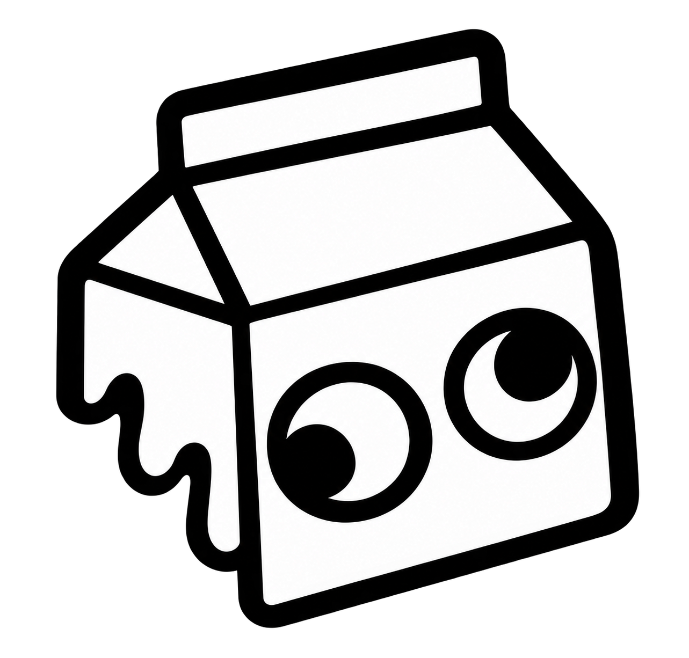
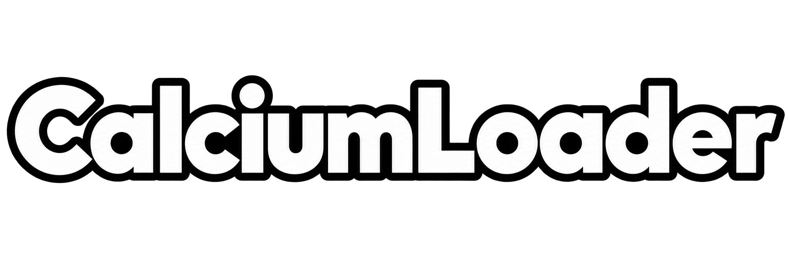

<div align="center">
  
  <br />
  

  <br />
  <br />

  **Open-source AI modding workspace for BONELAB code modders**

  *Prompt it. Generate it. Inspect it. Build it.*

  <br />

  
  
  
  
  
</div>

---

## CalciumLoader

**CalciumLoader** is a fully fledged, open-source desktop app for **BONELAB code modders**. It connects with supported code editors, uses AI to generate mod code from prompts, visualizes the building process through the **NODE Web**, and helps users organize, build, and deploy their BONELAB mods from one workspace.

It is designed to feel like a real developer tool, not just a prompt box.

---

## Features

### AI Mod Generation
- Turn natural language prompts into BONELAB code mods.
- Supports OpenAI-compatible APIs and local AI backends like Ollama.
- Generates structured **C# MelonLoader** projects for BONELAB PC modding.

### NODE Web Visualization
- A dedicated button under the prompt box opens the **NODE Web**.
- While the AI is building the mod, the node network simulates the live generation process.
- When generation finishes, the nodes reconstruct into the finished code-mod structure.

### Editor Integration
- Connect with different Visual Studio family editors and compatible code editors.
- Detect and launch:
  - Visual Studio Code
  - VS Code Insiders
  - VSCodium
  - Cursor
  - Windsurf
  - Visual Studio installations where supported

### Modular UI
- Clean desktop interface built for modders.
- Project browser, AI workspace, generation logs, file explorer, plugin management, and settings.
- Built with a modular structure so it can expand over time.

### Plugin Support
- Lightweight plugin system for extending prompts, templates, and workflows.
- JSON-based plugin manifests for safe, simple extensibility.
- Open-source friendly and easy to customize.

### Theme Engine
- Lightweight theme system with live switching.
- Includes built-in themes like:
  - Milk Dark
  - Milk Light
- Custom themes can be imported/exported with JSON.

### Build and Deploy Workflow
- Create BONELAB mod project structures.
- Open and edit generated source code.
- Build the DLL with the installed .NET toolchain.
- Deploy finished output to the BONELAB mods folder.

### Local Project Management
- Save generated projects locally.
- Browse source files and logs.
- Reopen projects later for editing and rebuilding.

---

## Why CalciumLoader?

CalciumLoader is made for BONELAB creators who want a better modding workflow.

Instead of juggling prompts, editors, build tools, and mod folders separately, CalciumLoader combines everything into one place:

- write your idea
- let AI generate the starting code
- watch the NODE Web visualization
- inspect and refine the source
- build the mod
- deploy it

---

## Tech Stack

| Layer | Technology |
|------|------------|
| Desktop App | Electron |
| Frontend | React + TypeScript + Vite |
| Backend | Electron Main Process |
| Mod Generation | AI API / OpenAI-compatible endpoints / Ollama |
| Mod Output | C# / .NET 6 / MelonLoader |
| UI System | Modular component-based interface |
| Visualization | Custom NODE Web animation |
| Themes | JSON-driven lightweight theme engine |
| Extensions | JSON plugin manifests |

---

## Main Modules

```text
CalciumLoader/
├─ electron/
│  ├─ main.ts
│  ├─ preload.ts
│  ├─ ai.ts
│  ├─ editors.ts
│  ├─ mods.ts
│  └─ core.ts
│
├─ src/
│  ├─ App.tsx
│  ├─ components/
│  │  ├─ NodeWeb.tsx
│  │  ├─ PromptPanel.tsx
│  │  ├─ ProjectExplorer.tsx
│  │  ├─ SettingsPanel.tsx
│  │  └─ ThemeManager.tsx
│  ├─ styles/
│  └─ types/
│
├─ resources/
│  ├─ plugins/
│  └─ themes/
│
├─ docs/
├─ .github/
├─ package.json
└─ README.md
